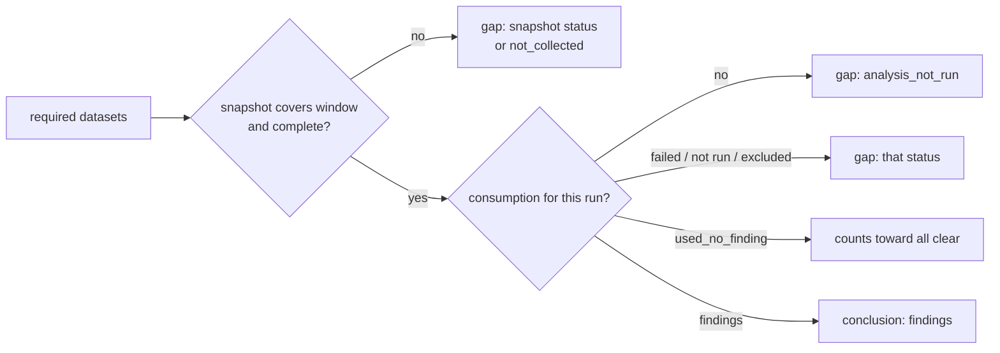

# Coverage and consumption contract

Stage B of the data-use plan (plan section 4) defined the contract. Stage D2 (plan R4) wires routines in:
amem-rsi-night and the morning brief are described below ("The night", "The brief").

Code: `src/agent_memory/coverage.py`, `src/agent_memory/night_coverage.py`. Schema:
`supabase/migrations/20261026150000_data_use_coverage.sql`. Tests: `tests/test_data_use_coverage.py`,
`tests/test_coverage_write.py`, `tests/test_coverage_night.py`, `tests/test_coverage_night_realistic.py`.

## Dataset names

A dataset is `<family>:<table>`, built with `coverage.dataset_key(family, part)`: the family key from
`data_families.py` and the table name as the part (`deviations:deviations`, `sessions:sessions`,
`routine_runs:runs`). Every routine names the same table the same way, so rows from different jobs line up. The
family must exist in `data_families.py`, so every dataset maps to its owner. A part that is not a table names the
provider an evidence query asked: `evidence_links:clickhouse`.

## Writing from a routine

Routines write through `coverage.record_best_effort`: one savepoint per record, never raises, and nothing at all
when `AMEM_COVERAGE_WRITE` is `0`, `off`, `false` or `no`. A record that fails is one problem line for the job's
notes. Coverage never changes the status or exit code of the job it describes.

## Two records

| Table | One row per | Natural key | Says |
|---|---|---|---|
| `coverage_snapshots` | dataset and time window | `dataset, window_start, window_end` | what was eligible, collected, linked and measured |
| `routine_consumption` | job run and dataset | `job, run_key, dataset` | what the job queried, considered, used and skipped, and what it found |

Both are upserts. Recording the same input twice leaves one row (`unchanged`). A later measurement of the same
window or run updates the row in place (`updated`). There is no per-row audit trail.

### Coverage snapshot

- `denominator`: the explicit population that `eligible` counts, for example "prod sessions modified in the
  scan window". "All historical sessions" is a different denominator.
- `eligible`, `collected`, `linked`, `unlinked`: counts. `eligible` null means the denominator could not be
  measured.
- `pending`, `rejected`, `expired`: records in those states.
- `measured_fields`, `unmeasured_fields`: at most 50 names each.
- `last_collected_at`, `last_analysed_at`, `source_versions`, `checkpoints`: freshness and the source state the
  counts belong to.
- `run_id`: the existing `runs` row of the job that measured it, when there is one.

### Routine consumption

- `job` and `run_key`: the same key `rsi_checkpoints` uses (for example `amem-rsi-night` and the night).
  `run_id` links the existing `runs` row. Nothing duplicates the run or checkpoint records.
- `analysis_version`, `window_start`, `window_end`, `source_checkpoint`: a reproducible input window instead of
  a list of every row read.
- `queried >= considered >= used`; `skipped` holds reason counts (`{"env_sandbox": 2}`).
- `findings`, and `evidence_refs`: at most 20 refs in the shared ref grammar (`amem:`, `ch:`, `lf:`, `past:`,
  `ncm:`, see `integrations/refs.py`). Cite the evidence a finding uses, not every row.

## Status vocabulary

`status` is a fixed vocabulary. Check constraints keep each status consistent with its counts.

| Record | Status | Meaning |
|---|---|---|
| snapshot | `complete` | every eligible record collected and linked, every field measured |
| snapshot | `no_eligible_data` | the denominator is empty |
| snapshot | `not_collected` | fewer records collected than eligible |
| snapshot | `collected_unlinked` | collected, but some records lack their link |
| snapshot | `measurement_unavailable` | the denominator or a field could not be measured |
| consumption | `findings` | the job used records and produced findings |
| consumption | `used_no_finding` | the job used records and found nothing |
| consumption | `read_excluded` | the job read records and excluded all of them |
| consumption | `analysis_not_run` | the job did not analyse this dataset |
| consumption | `analysis_failed` | the analysis started and failed |

The eight distinctions of plan section 4 are every status except `complete` and `findings`. When a caller passes
no status, `resolved_status()` derives it from the counts. Snapshot: unknown denominator, then empty, then
missing records, then unlinked records, then unmeasured fields. Consumption: findings, then used, then read,
then not run. `analysis_failed` is never derived: the caller says so.

## The "all clear" guard

`coverage.verdict(conn, job=..., run_key=..., required=[...])` returns:

- `all_clear` only when every required dataset has a consumption record for that run with
  `used_no_finding`, and a snapshot that covers the run's input window with `complete`;
- `findings` when any required dataset produced findings (the gaps are still listed);
- `incomplete` otherwise.

Each gap names the dataset and its distinction. A missing snapshot is `not_collected`; a missing consumption
record is `analysis_not_run`, and then the dataset's latest snapshot is judged instead of one for the run's
window. A consumption record without an input window cannot be matched to a snapshot, so it counts as
`not_collected`. `Requirement(dataset, allow_no_eligible=True)` lets an empty dataset pass when
"nothing to check" is an acceptable answer for that conclusion.



## The night (amem-rsi-night)

Code: `src/agent_memory/night_coverage.py`. The night feeds a `Ledger` while it runs and writes it once, at the
end (`Night._finish`). Key: job `amem-rsi-night` (the routine name; `rsi_checkpoints` keeps its own job
`rsi-night`), run key = the night (`2026-10-26`). `analysis_version` = `rsi-night/1 config <sha12>` (the night
config's hash). The input window is the S1 delta window `(since, until]`; `source_checkpoint` names the checkpoint
it started from and the one it advances to.

It writes only for a night this run owns: never for a dry run, never when a done night is run again (preflight
refuses before the night owns it), so a rerun of a done night adds no rows. A failed night's rerun updates its
consumption rows in place; a new input window is a new snapshot row.

### Datasets and their counts

| Dataset | From | queried / considered / used | skipped | findings |
|---|---|---|---|---|
| `sessions:sessions` | S1 | rows read / 0 / 0 | - | always `analysis_not_run`: the night counts sessions and analyses them through their deviations |
| `deviations:deviations` | S1, S2 | new deviations / all / those in a current-rule candidate group | `team_rule`, `not_a_current_rule_in_lookback` | deviation sightings |
| `routine_runs:runs` | S1, S2 | failed runs / all / those with a routine name | `no_routine_name` | routine sightings |
| `experiments:rsi_eval_results` | S1, history | eval failures / with an experiment id / attached to a candidate | `no_candidate`, `no_experiment_id` | attached failures |
| `experiments:rsi_experiments` | S1, history | experiments / with an id / attached to a candidate | `no_candidate` | 0 (history, not a problem) |
| `evidence_links:rsi_evidence` | S1, S2 | stored evidence links / all / ok links checked against `finding_min_n` | link status (`unlinked`, `stale`), `over_cap` | finding sightings |
| `skills:skill_scores` | S2 | low scores / all / all | `skill_refresh_<status>` when the prerequisite skips skills | skill sightings |
| `evidence_links:<provider>` | S1 provider steps + every S4 pack | rows the provider returned / rows that reached the night / ok rows | link status, `pack_limit`, `over_cap` | S1 sightings + S4 ok rows (supporting evidence for a candidate under investigation) |

`<provider>` is `supabase`, `clickhouse`, `langfuse` or `pastdev`, one row per night for every provider a step
asked for data (a health check of an idle provider does not count). A row below its threshold (`below_min_n`) is
used without a finding: the night measured it and found it too small.

Snapshots: one per S1 dataset for the night window (the night is the job that knows these denominators: the
stored rows its delta query selects), and one per asked provider. An S1 snapshot whose delta read hit the page
limit counts the full window and is `not_collected` ("the delta read 3 of 5 rows"); the rest is read next night.
A provider snapshot counts rows; its `measured_fields` / `unmeasured_fields` are the steps that answered and the
steps that did not (`s1:ch.rule_gap`, `s4:pd.recall`). No snapshot for `skills:skill_scores` (rsi-nightly's
refresh owns it).

### Statuses

- Empty window: snapshot `no_eligible_data`, consumption `analysis_not_run` with nothing queried.
- Rows read, not analysed: `analysis_not_run` (sessions) or `read_excluded` (every row skipped). Never
  `used_no_finding`.
- A sighting source that raised: that dataset is `analysis_failed` with the error; the other sources go on.
- The night stopped before a dataset was analysed: `analysis_not_run` (preflight, abort, budget) or
  `analysis_failed` (an error), with the night's last note.
- A provider that answered no step: `analysis_not_run` when every step was `unavailable`, `analysis_failed` on an
  error or timeout, with the step reasons the report's `health_reasons` carry. Its snapshot is
  `measurement_unavailable`. Some steps answered: the counts decide the status, and the snapshot is still
  `measurement_unavailable`.
- A provider the owner switched off (health `skipped`): `analysis_not_run` ("switched off by the owner"), no
  snapshot, and not required.

### Report and failures

`report.coverage` (optional, validated by `rsi_night.validate_report` and `rsi_brief.validate_report`):

```json
{"job": "amem-rsi-night", "run_key": "2026-10-26", "enabled": true, "analysis_version": "rsi-night/1 config 3f2a…",
 "consumption": {"findings": 2, "analysis_not_run": 5}, "snapshots": {"complete": 4, "no_eligible_data": 3},
 "datasets": {"deviations:deviations": "findings", "...": "..."}, "required": ["deviations:deviations", "..."],
 "failed": 0}
```

`consumption` and `snapshots` count the rows written per status; `datasets` maps each written consumption row to
its status; `failed` counts records not written. Each record is written in its own savepoint; a failed one is a
night note (`coverage consumption <dataset>: <error>`). A bug in the ledger itself writes nothing (a note says
why) rather than rows with wrong counts. With `AMEM_COVERAGE_WRITE=0` nothing is written and `enabled` is false.
None of this changes the night's status, checkpoint or exit code.

## The brief (amem-rsi-brief)

`rsi_brief.coverage_verdict` calls `coverage.verdict(conn, job="amem-rsi-night", run_key=<night>, required=...)`
read-only. `required` is `night_coverage.requirements(report.coverage.required)`:

- always: `deviations:deviations`, `routine_runs:runs`, `experiments:rsi_eval_results`,
  `experiments:rsi_experiments`, `evidence_links:rsi_evidence` (what candidate discovery and triage history read);
- plus every provider dataset the night asked and the owner did not switch off.

Every requirement allows an empty window (`allow_no_eligible`): the night runs only after amem-daily passed for it
(rsi_schedule's prerequisite gate), so an empty window means nothing new to check. The brief names those datasets.
Sessions are not required (only counted); skills are not required (the refresh owns their snapshot).

| Verdict | Brief line |
|---|---|
| `all_clear` | **Verdict: No problem found.** ... Nothing new to check in: <datasets with an empty window>. |
| `findings` | **Verdict: Findings (N).** ... Coverage gaps: <dataset distinctions (reason)>. |
| `incomplete` | **Verdict: Analysis incomplete.** Missing evidence, so this is not an all clear: <gaps>. |
| no `report.coverage`, or `enabled: false` | **Verdict not recorded:** <why>. This is not an all clear. |
| coverage tables unreadable | **Verdict unknown:** coverage not read (<error>). This is not an all clear. |

Only `all_clear` prints "No problem found". An unavailable provider is a gap, so it shows as incomplete for that
dataset. The verdict is the brief's `verdict` key and the markdown line right after the run line; the phone
summary has one `Verdict: ...` line.

## Access

RLS is on for both tables. The routine role `amem_app` may read, insert and update (no delete). Night Desk's
owner (authenticated, `auth.uid() = amem_owner_uid()`) may read. `anon`, `service_role`, `rsi_reader`, a
signed-in non-owner and any other role get nothing.
