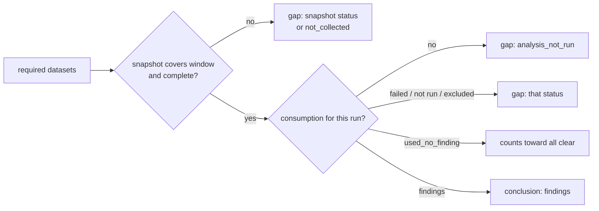

# Coverage and consumption contract

Stage B of the data-use plan (plan section 4). Contracts and fixtures only: no routine records anything yet.
Stages D to F wire the routines in.

Code: `src/agent_memory/coverage.py`. Schema: `supabase/migrations/20261026150000_data_use_coverage.sql`.
Tests: `tests/test_data_use_coverage.py`.

## Two records

| Table | One row per | Natural key | Says |
|---|---|---|---|
| `coverage_snapshots` | dataset and time window | `dataset, window_start, window_end` | what was eligible, collected, linked and measured |
| `routine_consumption` | job run and dataset | `job, run_key, dataset` | what the job queried, considered, used and skipped, and what it found |

Both are upserts. Recording the same input twice leaves one row (`unchanged`). A later measurement of the same
window or run updates the row in place (`updated`). There is no per-row audit trail.

### Coverage snapshot

- `denominator`: the explicit population that `eligible` counts, for example "prod sessions modified in the
  scan window". "All historical sessions" is a different denominator.
- `eligible`, `collected`, `linked`, `unlinked`: counts. `eligible` null means the denominator could not be
  measured.
- `pending`, `rejected`, `expired`: records in those states.
- `measured_fields`, `unmeasured_fields`: at most 50 names each.
- `last_collected_at`, `last_analysed_at`, `source_versions`, `checkpoints`: freshness and the source state the
  counts belong to.
- `run_id`: the existing `runs` row of the job that measured it, when there is one.

### Routine consumption

- `job` and `run_key`: the same key `rsi_checkpoints` uses (for example `amem-rsi-night` and the night).
  `run_id` links the existing `runs` row. Nothing duplicates the run or checkpoint records.
- `analysis_version`, `window_start`, `window_end`, `source_checkpoint`: a reproducible input window instead of
  a list of every row read.
- `queried >= considered >= used`; `skipped` holds reason counts (`{"env_sandbox": 2}`).
- `findings`, and `evidence_refs`: at most 20 refs in the shared ref grammar (`amem:`, `ch:`, `lf:`, `past:`,
  `ncm:`, see `integrations/refs.py`). Cite the evidence a finding uses, not every row.

## Status vocabulary

`status` is a fixed vocabulary. Check constraints keep each status consistent with its counts.

| Record | Status | Meaning |
|---|---|---|
| snapshot | `complete` | every eligible record collected and linked, every field measured |
| snapshot | `no_eligible_data` | the denominator is empty |
| snapshot | `not_collected` | fewer records collected than eligible |
| snapshot | `collected_unlinked` | collected, but some records lack their link |
| snapshot | `measurement_unavailable` | the denominator or a field could not be measured |
| consumption | `findings` | the job used records and produced findings |
| consumption | `used_no_finding` | the job used records and found nothing |
| consumption | `read_excluded` | the job read records and excluded all of them |
| consumption | `analysis_not_run` | the job did not analyse this dataset |
| consumption | `analysis_failed` | the analysis started and failed |

The eight distinctions of plan section 4 are every status except `complete` and `findings`. When a caller passes
no status, `resolved_status()` derives it from the counts. Snapshot: unknown denominator, then empty, then
missing records, then unlinked records, then unmeasured fields. Consumption: findings, then used, then read,
then not run. `analysis_failed` is never derived: the caller says so.

## The "all clear" guard

`coverage.verdict(conn, job=..., run_key=..., required=[...])` returns:

- `all_clear` only when every required dataset has a consumption record for that run with
  `used_no_finding`, and a snapshot that covers the run's input window with `complete`;
- `findings` when any required dataset produced findings (the gaps are still listed);
- `incomplete` otherwise.

Each gap names the dataset and its distinction. A missing snapshot is `not_collected`; a missing consumption
record is `analysis_not_run`, and then the dataset's latest snapshot is judged instead of one for the run's
window. A consumption record without an input window cannot be matched to a snapshot, so it counts as
`not_collected`. `Requirement(dataset, allow_no_eligible=True)` lets an empty dataset pass when
"nothing to check" is an acceptable answer for that conclusion.

## Access

RLS is on for both tables. The routine role `amem_app` may read, insert and update (no delete). Night Desk's
owner (authenticated, `auth.uid() = amem_owner_uid()`) may read. `anon`, `service_role`, `rsi_reader`, a
signed-in non-owner and any other role get nothing.
