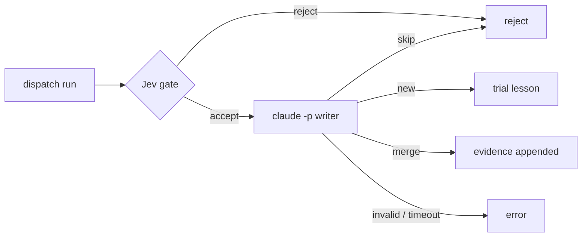

# Lessons

A lesson is a short rule learned from a run. The loop:

1. **Propose.** `amem lesson propose` asks Jev whether a run holds a reusable lesson. Only a clear yes is stored, as `trial`.
2. **Inject.** `amem lessons for` picks the best lessons for a task and prints a block for the worker brief. Each injection is logged in `lesson_uses`.
3. **Score.** `amem lessons score` compares runs that got a lesson with runs in the same scope that did not.
4. **Retire.** A lesson with enough uses that never beats the baseline becomes `retired`.

`lessons.md` stays the human view. `amem lessons import` and `amem lessons export` move lessons between the file and the table.

Postgres only in V1. Jev gates. Only `lessons distill` calls an LLM (the headless Claude Code CLI) to write lesson text, and only with `AMEM_DISTILL_LIVE=1`.

## Tables

Migration `supabase/migrations/20261014030000_lessons.sql`.

`lessons`

| Column | Meaning |
|---|---|
| `slug` | Unique. The lessons.md `Id:`. |
| `title`, `rule` | The heading, and what a worker should do. Imported lessons have `rule = title`. |
| `scope_repo` | Null = every repo. |
| `scope_task` | Null = every task. Otherwise a phrase the task text must contain (case-insensitive). |
| `status` | `trial`, `kept`, `retired` or `promoted`. |
| `source_run_ids` | The runs the lesson came from (`uuid[]`). |
| `evidence`, `evals`, `promoted_to`, `since` | From lessons.md. |
| `tsv` | Generated `tsvector` (english): title weight A, rule B, evidence C. GIN index. |
| `embedding` | `vector(1536)`, null. Reserved for later; V1 never fills it. Only added when pgvector is installed (on Supabase it lives in schema `extensions`). |

`lesson_uses`: one row per injection. `lesson_id`, `run_id` (nullable), `injected_at`, `context` (the task text), `outcome` (`pass`, `fail`, `unknown` or null).

Both tables have RLS on with no policies, and no grants for `anon`/`authenticated`, like `runs`.

## Commands

| Command | Does |
|---|---|
| `amem lessons import PATH` | Upserts lessons from a lessons.md file by `Id`. Prints `imported N new, M updated`. Unchanged lessons count as neither. |
| `amem lessons export` | Prints every lesson in lessons.md format. |
| `amem lessons for --repo R --task "..." [--limit 5] [--run ID] [--min-relative-rank 0.2]` | Prints a markdown block for a brief and records one `lesson_uses` row per lesson. |
| `amem lessons score [--min-uses N] [--repo R] [--apply]` | JSON lines, one per active lesson. Dry run unless `--apply`. |
| `amem lesson propose --run ID [--repo R] [--task T]` | Jev write gate. Prints `accept ...` or `reject ...`. |
| `amem lessons distill [--since ISO] [--limit 10] [--dry-run]` | Dispatch runs → trial lessons (Jev gate + Claude Code writer). Needs `AMEM_DISTILL_LIVE=1`. See [Distill](#distill-lessons-distill). |
| `amem gate friction --text "..." [--seen N]` | Jev improver gate. Prints `accept\|reject confidence=...`. |

Write commands (`import`, `for`, `propose`, `score --apply`, `distill`) obey `AMEM_REQUIRE_REMOTE=1` against `AMEM_DB_URL` and exit 3 like the other write commands.

Lessons are Postgres-only in V1. On the REST backend (`AMEM_BACKEND=rest`, see docs/cloud.md) every lessons command except `gate friction` exits 1, because the runs live in another store.

## lessons.md format

```
### <title>
Id: <slug>
Evals: <text>
Promoted-to: <text>
Evidence: <text; may continue over more lines and blank-line paragraphs>
Status: trial | kept | retired | promoted
Since: YYYY-MM-DD
```

- Text before the first `### ` is a preamble and is ignored.
- Only the next `### ` heading ends a lesson. Every other line belongs to the current lesson, `# ` and `## ` lines included. A `## Archive` line after the last lesson is text of that lesson; put sections before the first lesson.
- A key starts a field. Every next line that is not a key continues that field.
- Keys are case-sensitive and written `Key: value` (one space after the colon, or nothing).
- `Status: reverted` (the old word) is read as `retired`. A missing status is `trial`.
- A missing `Id:` becomes a slug of the title.
- Export adds optional keys when the table has the data: `Rule:` (rule differs from title), `Repo:`, `Task:`, `Source-runs:`.
- Optional keys inside Evidence. Export writes `Rule:`, `Repo:` and `Task:` before `Evidence:` and `Source-runs:` after it. So:
  - `Rule:`, `Repo:` and `Task:` are keys only before `Evidence:`. After it, a line like `Task: rewrite everything` is Evidence text, not a new scope.
  - After `Evidence:`, `Source-runs:` is a key only when its whole value is uuids (what export writes). `Source-runs: see the log` is text.
- A line that would be a key at that point but has the wrong case or no space (`status: kept`, `ID: x`, `Status:kept`) stops the import with exit 1 and names the line. It is never glued into the previous field. A line that is text at that point (`task: ...` after Evidence) stays text.
- Unknown status, a bad date, a repeated key, a miscased key or a repeated `Id` stops the import with exit 1. Nothing is written.

Round trip: import, export, import again prints `imported 0 new, 0 updated`.

Import treats the file as the truth for the lessons it holds. Re-importing an old file resets their status, for example a lesson that `score --apply` retired.

## Retrieval: `lessons for`

- Query: `websearch_to_tsquery('english', task)`. AND is relaxed to OR, so any matching term retrieves. A query with a negation (`-word`) stays strict.
- Positive part: `querytree(query)`, the terms a lesson must contain (`x -y` gives `x`). Hits are ranked by `ts_rank` against this part, so exclusions do not distort the rank.
- No positive part: a task with only negations (`-x`, `-x -y`, `-"x y"`) or `x or -y` matches every lesson that lacks a word. It prints nothing and records nothing.
- Filter: status `trial`, `kept` or `promoted`; `scope_repo` null or equal to `--repo`; `scope_task` null or contained in the task.
- Order: `ts_rank` desc, then repo-scoped before global, then promoted, kept, trial.
- Noise cut: a hit ranked below 0.2 x the top hit is dropped and not recorded. OR matching would otherwise pull in a lesson that shares one common word with the task. Set `--min-relative-rank` or `AMEM_LESSONS_MIN_RELATIVE_RANK` (0 keeps all hits with rank > 0). A hit with rank 0 is never printed or recorded.
- No match, or only stop words: prints nothing, records nothing.
- A task that starts with `-` must be passed as `--task=-word` (argparse reads `--task -word` as a missing value).
- `AMEM_MEMORY=off` is the A/B switch: prints nothing, records nothing, exit 0.

Example output:

```
## Lessons from past runs

Follow these unless the task says otherwise:

- **Workers: no compound `cd && ...` or heredoc chains ...** (`no-compound-cmds`, promoted)
```

## Write gate: `lesson propose`

Jev gets a state built from the run: routine, status, repo, task, summary, failure reason and `meta.failures`. The state holds no ids or timestamps, so fixtures stay stable.

Questions:

- `reusable`: noul "Is there a reusable lesson in this run?" (value = P(yes))
- `generalizable`: score "How generalizable (0-1)?" with levels `Specific to this one run`, `Applies to many future runs` (value = expected score in 0..1)

Accept when both pass:

| Threshold | Flag | Env | Default |
|---|---|---|---|
| P(reusable) | `--min-reusable` | `AMEM_PROPOSE_MIN_REUSABLE` | 0.6 |
| generalizable | `--min-generalizable` | `AMEM_PROPOSE_MIN_GENERALIZABLE` | 0.5 |

On accept, a deterministic template writes the lesson. Slug: `<routine>-<first 8 chars of run id>`. Title and rule come from the failure reason, else the first failure, else the summary. Status `trial`, `since` = the run date, `source_run_ids = [run]`. Proposing the same run again leaves the stored lesson alone.

Exit 0 on accept or reject. Exit 1 on an unknown run, a database error or a missing Jev fixture.

## Distill: `lessons distill`

```
amem lessons distill [--since ISO] [--limit 10] [--dry-run] [--retry-errors] [--timeout 120]
```

Turns finished dispatch runs into new `trial` lessons. This is the only command that calls an LLM to write lesson text.



**Candidates.** Runs with `routine = 'dispatch'` (any source) that have no `lesson_candidates` row, newest first, at most `--limit` (default 10, bounds cost). `--since` keeps runs started at or after that time. `--retry-errors` also takes runs recorded as `error`.

**Input shape** (from `amem ingest tasks`): `meta.repo` (required; a run without it is an `error`), `meta.task_id`, `meta.dod_first_pass`, `meta.follow_ups`, `meta.denials`, and `meta.workers[]` with `name`, `final_status`, `reasons[]`, `denied_shapes{}`, `brief_gaps[]`, `errors{}`, `checkpoint_excerpt`.

**Per run:**

1. **Jev gate.** The `lesson propose` questions and thresholds (`AMEM_PROPOSE_MIN_REUSABLE`, `AMEM_PROPOSE_MIN_GENERALIZABLE`) on a state built from the run: status, summary, task, DoD first pass, follow-ups, denials and, per worker, status, reasons, denied shapes, brief gaps, errors and the checkpoint excerpt (max 1500 chars). No ids or timestamps, so fixtures stay stable. Jev follows the normal fixture/live rule.
2. **Writer.** `claude -p --model sonnet --output-format json --tools "" --no-session-persistence`, prompt on stdin, 120 s timeout (`--timeout`). Tools are off because the prompt holds run text written by agents. The prompt holds the state and the 5 closest active lessons in scope (full-text search; nothing is recorded in `lesson_uses`). The model must answer one JSON object: `{"action": "new"|"merge"|"skip", "merge_slug", "title" (≤120), "rule" (≤300, "When X, do Y, avoid Z."), "scope_task" (null or ≤60), "evidence" (≤1000)}`. One code fence around it is tolerated.
3. **Write.**
   - `new`: a `trial` lesson. Slug `<repo>-<first 8 hex of sha256(run id)>`, `scope_repo` = `meta.repo`, `source_run_ids = [run]`, `since` = run date. Evidence starts with `Distilled from dispatch run <id> (...)` and ends with the Jev scores.
   - `merge`: `merge_slug` must be one of the offered lessons. Its evidence gets a new paragraph and the run id is appended to `source_run_ids`. Its status never changes. Merging the same run twice is a no-op.
   - `skip`: recorded as `reject`.

The lesson write and the `lesson_candidates` row commit in one transaction.

**Never blocks.** A missing `meta.repo`, a Jev error, a writer failure (not found, timeout, non-zero exit), an invalid envelope or invalid model JSON is recorded as `error` for that run, and the next run goes on.

**Output.** One line per run (`accept new run <id> repo=<r> -> lesson <slug>: ...`, `reject gate ...`, `reject skip ...`, `error error ...`), then:

```
distilled N runs: A new, M merged, R rejected, E errors
```

Exit 0, or 1 when E > 0. `--dry-run` runs the gate and the writer but writes nothing (the summary says so).

**Live switch.** Without `AMEM_DISTILL_LIVE=1` the command exits 2: nothing is called or written. `AMEM_DISTILL_CLAUDE` replaces the `claude` executable (a path; tests and demos point it at a fake). Write mode obeys `AMEM_REQUIRE_REMOTE=1` (exit 3).

**Table** `lesson_candidates` (migration `20261015020000_lesson_candidates.sql`): `run_id` (pk, cascades with the run), `decision` (`accept`, `reject`, `error`), `reason`, `lesson_id` (accept only), `considered_at`. RLS on, no grants for `anon`/`authenticated`.

**Daily.** `amem daily` runs distill after the scoring step (limit 10). With the live flag off the step is off: not a failure, and the log line is unchanged. When it ran, the line adds `distilled=N lessons_new=A lessons_merged=M lessons_rejected=R distill_errors=E`. Any `error` run fails the step (`amem-daily-fail distill: ...`); later steps still run.

## Improver gate: `gate friction`

Question `recurring`: noul "Is this a recurring friction, not a one-off?". The state is the text plus `Seen N time(s) so far.` when `--seen` is given.

- Accept when P(recurring) >= `--min` / `AMEM_FRICTION_MIN` (default 0.5).
- Output: `accept|reject confidence=C p_recurring=P threshold=T`. `confidence` is the probability of the printed decision (P for accept, 1 - P for reject).
- Exit 0 accept, 1 reject, 2 no decision (Jev error, missing fixture).

## Scoring: `lessons score`

Per active lesson (`trial`, `kept`, `promoted`):

- **Uses**: `lesson_uses` rows with a known outcome. `outcome` pass/fail wins. Otherwise the linked run's status: `pass` is pass, `fail`/`error` is fail. A run counts once.
- **Baseline**: non-skip runs in the lesson's repo scope that never got this lesson. A run's repo is `runs.meta.repo`, else its routine name. A null-scope lesson uses every run. `scope_task` is not used here (runs have no task field).
- **Decision**:
  - `insufficient`: uses < `--min-uses` (default 3, or `AMEM_SCORE_MIN_USES`), or zero uses whatever the minimum is. `--min-uses` and `AMEM_SCORE_MIN_USES` must be positive integers. A bad env value (`0`, `-3`, `0.5`, `abc`) stops with `amem: lessons score: AMEM_SCORE_MIN_USES must be a positive integer ...` and exit 2, before any database access; nothing is written.
  - `no_baseline`: no baseline runs
  - `keep`: pass rate with the lesson > baseline pass rate
  - `retire`: otherwise, for `trial`/`kept`
  - `review`: otherwise, for `promoted`. A promoted lesson is part of the worker rules, so a human decides.
- `--apply` writes `status = retired` for `retire` rows. It never promotes.

Each line: `slug`, `status`, `scope_repo`, `uses`, `uses_pass`, `with_pass_rate`, `baseline_runs`, `baseline_pass`, `baseline_pass_rate`, `decision`, `applied`.

## Jev fixtures

Tests never call Jev. Fixtures live in `tests/fixtures/jev/<key>.json`, where `key = jev.fixture_key(state, questions)`. Use `lessons.propose_state(...)` or `lessons.friction_state(...)` with `lessons.PROPOSE_QUESTIONS` / `lessons.FRICTION_QUESTIONS` to compute a key for a new case.
