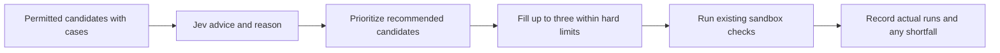

# Daily experiment minimum and target

Vilmer's instruction, 27 October 2026: run at least one experiment per day, with a goal of three.

The scheduled subscription profile sets `triage.minimum_experiments` to 1 and
`triage.target_experiments` to 3. The existing hard budget still permits at most three
experiments. No money, model-call, token, container, time or promotion limit is raised.
Profiles without a minimum retain their previous Jev veto behavior.

## Selection

The scheduler considers the existing bounded pool of testable candidates. Jev's
`experiment` recommendations come first, ranked by the existing score. If there are
fewer than three, lower-priority candidates can fill the remaining slots. A Jev
`wait` recommendation and a low ranking score are priority advice under this policy.
The report preserves that advice and separately records why the scheduler selected
the candidate for exploration.

Only permitted targets with applicable replay cases can enter this selection.
Pins, fences, prerequisite checks, credential isolation, hypothesis validation,
staging checks and promotion approval continue to apply. Meeting a daily target
does not authorize promotion or make an unsuccessful replay pass.

If a selected candidate produces no usable hypothesis, another already-assessed
candidate can fill its unused slot. This does not request a second batch of paid
Jev calls, repeat a failed hypothesis, or exceed any budget. Once three experiment
attempts have consumed the existing allowance, further preparation stops.

## Reasons and honest counts

The same Jev call now asks for a typed main reason as well as its action and scores.
The reason can identify rare evidence, low benefit, poor testability, a previous
no-effect or worse result, instruction changes being unlikely to help, risk,
scope, or another concern. This is Jev's stated main reason, not a complete written
chain of reasoning. The report and morning brief keep the code and plain explanation.
Legacy missing reasons remain unknown; scores are never turned into invented causes.

`report.experiment_goal` records the minimum, target, attempts, experiments with
replay runs, whether each goal was met, and shortfall reasons. A candidate merely
being selected, a rejected hypothesis, a staging failure, a deferred second
hypothesis, or a replay adapter returning zero runs does not meet the minimum.
An experiment with actual replay runs can count even if it finds no improvement:
the purpose is to learn, not to require three successful changes.

Three is a target, not permission to fabricate candidates or bypass controls. If
there is only one safe, testable candidate, it runs once. If there are none, or hard
limits or failures prevent any replay, the minimum is explicitly unmet and the
night is partial (or retains its more specific failure status). A warning in the
night report and morning brief explains the shortfall. No software can guarantee a
completed experiment during a credential failure, outage, or exhausted hard budget.

## Verification scope

Local tests use a disposable database, temporary instruction homes and synthetic
adapters. They cover all-five-wait selection, one/two candidates, an empty pool,
pins, missing replay cases, invalid-hypothesis backfill, staging refusal, zero-run
results, budget exhaustion, typed reasons, missing historical reasons, and morning
brief output. The existing worst-case three-experiment budget checks retain their
call, time, token and container assertions. Their double now reports the twelve
agent attempts that it already books, instead of incorrectly returning zero.

Jev fixtures are explicitly synthetic. Their filenames change because the question
set changed. No saved production answer, report or experiment is re-scored.
No paid run is required for local verification. The next natural scheduled run is
still needed to establish live provider behavior.
