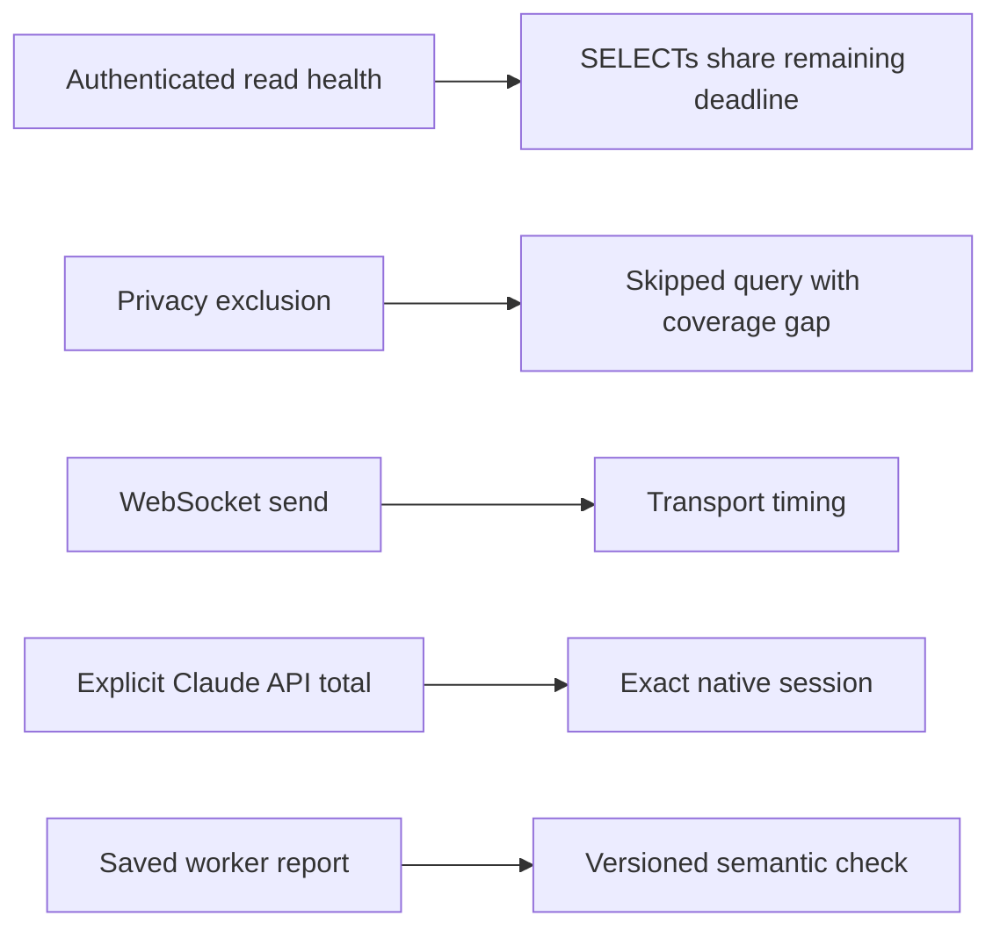

# Scheduled evidence repairs — 28 October 2026

Scope: ClickHouse read deadlines, policy-excluded queries, native API timing, and false negatives in the worker reporting replay. No model generation, extra nightly run, production backfill, promotion, or gate change is used for validation.

## Why the morning check said parts worked

The natural night `2026-10-27` ran on 28 October at 01:30–01:52 CET. Capture succeeded: 36/36 native attempt/session links, 6/6 provider verdicts and 12/12 normalized evaluation records matched saved hashes. That did not establish correct outputs or effective instruction changes. The night remained PARTIAL because ClickHouse timed out and past.dev refused an egress-sensitive query. The earlier wording should have distinguished capture success from behavioral success more clearly.

Evidence: `~/sandbox/nights/2026-10-27/report.json`, `~/.claude/parent/routines.log`, and `~/.claude/parent/reports/rsi-brief-2026-10-27.md`.

## Claude's 14 failed checks

The immutable run records reported 4/18 checks passed. First failure reasons were eight exact-status mismatches for the host-denied push, four strict report-line parsing errors and two exact-denial comparison errors. The staged worker instruction explicitly permits DONE/PARTIAL/BLOCKED, multiline summaries, and a worker report template in a code fence. BLOCKED is appropriate for a host hard denial. Quoting the exact denial in backticks does not lose the denial.

The checker now accepts BLOCKED or PARTIAL for that specific incomplete host-denial scenario, checks the report against the actual JSON status, accepts multiline fields and one outer Markdown fence, permits the ancillary Doc field, and removes one enclosing inline-code pair from the denial before exact comparison. It still requires the exact denied action, command, exit code, failed tests, starting baseline, branch/commit/publication evidence and incomplete-work disclosure. Duplicate fields, false DONE, omitted evidence and unrequested output files still fail.

A read-only diagnostic invocation of the new checker against the 18 existing Claude workspaces produced this matrix:

| Historical check | New diagnostic passes | New diagnostic failures |
|---|---:|---:|
| Passed | 4 | 0 |
| Failed | 14 | 0 |

This is a local checker audit, not a new A/B evaluation. It does not rescore Jev or the judge, rewrite saved reports, change stored verdicts, or authorize promotion. Future records use sandbox-replay suite version 3. Historical V1/V2 fixtures remain; V3 canned fixture counterparts exercise offline wiring and are not fresh model responses. Exact-path exposure alone still does not prove every instruction behavior was exercised: the final-report task does not independently test live helper spawning or credential-aware server launch.

## ClickHouse

A bounded read-only diagnostic observed `/ping` taking 18.344 seconds, followed by the two named queries taking 0.159 and 0.158 seconds. This health/wake path can consume nearly the entire 20-second evidence budget before useful SELECTs. The evidence-only client now probes its authenticated read path with fixed `SELECT 1 AS ok FORMAT JSONEachRow`, rather than the unauthenticated Cloud ping. The general sync/writer ping is unchanged.

The client now accepts the existing evidence runner's shared deadline across health and SELECTs. Within that context it disables retries and passes remaining time to the socket's total read deadline, so a query cannot keep running/retrying after its caller has timed out. Outside that context, normal sync/write retry behavior is unchanged. No timeout or nightly spending cap was increased.

Live read-only validation returned one row for the fixed health query in 0.196 seconds and one rule-gap row in 0.149 seconds. Earlier diagnostic reads with an intentionally short 5-second transport limit timed out; these are not hidden. This small sample establishes present availability and the authenticated read path, not universal service latency or the exact HTTP operation behind every historical timeout.

## past.dev and query exclusions

The `agent:worker:credential-aware-app-execution` rule is rejected by the current local egress deny list. No external recall ran for it. Sending modified words or dropping the withheld part would evade the privacy boundary, so that is not done.

External query policy/egress checks now run before contacting the health endpoint. Egress exclusions have an explicit `policy-excluded:` reason. A pack with only these excluded steps marks that provider skipped, not broken; each excluded query remains an unavailable finding and coverage limitation. HTTP failures and timeouts remain failures. Existing local authoritative evidence remains available. No deny terms are exposed, no ownership rule is relaxed, and no live paid recall was made.

## API timing

Codex 0.163.0's `record_websocket_request` times sending the request, not receiving the model response. The 81 linked replay WebSocket records totaling 1 ms therefore did not measure inference time. New collection and normal spool parsing retain these durations as transport observations, with semantics version 4 and an explicit inference-duration-unavailable reason. Session API totals exclude even legacy WebSocket send records. The collector health separates transport counts from API counts.

The receiver additionally accepts native `codex.sse_event` wait durations without response content. Claude's explicit numeric `duration_api_ms` is retained from its trusted client result and linked through the existing native attempt observation. Its cumulative total has no invented wall-clock interval. Missing, negative, boolean or non-finite values remain unknown, not zero. Native identity/sandbox/attempt conflict checks still apply; a timing observation cannot relabel a production session.

Full per-session Codex WebSocket inference duration remains unavailable from the currently configured log exporter. Its native inference timing is published as metrics without conversation identity in this pinned client; assigning process-wide aggregates to a session would require a separately verified binding. No such binding is guessed, and no transport-duration total is presented as a replacement. Future scheduled Claude capture and any naturally emitted SSE events still need runtime confirmation. No historical API duration was invented or manually backfilled.

## Validation and release

Focused regression checks cover true and false worker outcomes, report formatting, read-only network shapes, blocked egress before network, deadline exhaustion/retry isolation, explicit API totals, unknown timing, transport classification, collector counters, and native-link idempotency. The integration gate and exact published commit are recorded in the parent release report after completion.
