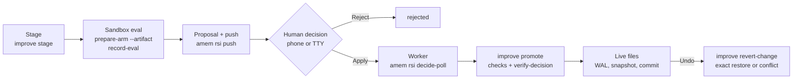

# Mission 003 report: Safe Foundation & Approval-First RSI

Date: 2026-10-16. Status: **complete for build and test. Nothing is activated.** Production is **not
frozen**: the existing automatic writers are still active (W1 amem-daily edits, W2 improve via
amem-daily, W3 `ab-lessons-monthly`).

## Result

The approval-first RSI path is built and tested end to end on local, disposable infrastructure:
- a change is staged in the sandbox as a hash-bound artifact;
- a human approves it (phone or terminal);
- a single worker promotes those exact bytes;
- undo restores the exact previous bytes;
- an interrupted promotion recovers from a write-ahead log.

Staging never writes production. Promotion refuses every case the mission listed. Sandbox isolation
was verified with 110 tests against real containers. The encrypted transcript archive passed its
synthetic-data tests.

No production migration, schedule, hook, configuration, credential or branch was changed. Nothing
was pushed or deployed.

## Definition of done

| Item | Status | Evidence |
|------|--------|----------|
| Approval-first implementation exists and is tested | Done | `improve e2e-promote` 30/30; `tests/test_rsi_approval.py` 21; `tests/test_edits_stage.py` 2; real cross-repo test |
| Sandbox isolation verified | Done (limits below) | `sandbox/tests` 110/110 against real Docker workers |
| Transcript archive passes synthetic-data tests | Done | 37 archive tests; real dry run, no writes |
| Staging cannot write production | Done | tree + git HEAD check in e2e-promote; byte checks in the stage-mode and cross-repo tests |
| Apply requires a valid human decision | Done (one residual risk, see F) | forged, expired, reused, wrong-hash and missing decisions all refused; agent sessions refused |
| Undo and crash recovery work | Done | exact undo, conflict without writes, 3 crash points recovered |
| Existing routines remain operational | Done | full agent-memory suite; legacy `improve e2e` 49/49; `improve selftest` |
| No production change without approval | Done | read-only checks: main checkouts, `CLAUDE.md` hash, launchd plist, no WAL, no remote branches |
| Activation and rollback plan ready | Done | [activation.md](activation.md), tested [rollback_rsi_core.sql](rollback_rsi_core.sql) |

Some checks need production access, so they are not verified yet. Each is a check step in the
activation checklist:
- a real Keychain write (`amem archive init`);
- a real model run in the sandbox;
- the hosted migration;
- the edge function deploy;
- a real phone push and tap.

## A. Implementation summary

**Phase A: writers and freeze.**
- [writers.md](writers.md) lists every production writer:
  - W1–W5: improvement writers;
  - P1–P7: protective writers (revert, recheck, fence-check, autopin, …);
  - telemetry, external and human writers.
- [freeze.md](freeze.md) is the freeze procedure, using existing controls:
  - `max_changes_per_week: 0`;
  - remove `AMEM_EDITS_LIVE` from the amem-daily plist;
  - disable `ab-lessons-monthly`.

  It has a backup step, a verify step and an undo step. **Not executed.**
- `amem rsi freeze-status` checks it. It prints `NOT FROZEN` today, with all four reasons.

**Phase B: transcript archive** (`amem archive`, [../archive.md](../archive.md)).
- Encryption: AES-256-GCM, with each blob bound to its path, hash and time (AAD).
- An encrypted, hash-chained manifest and index. Incremental, with dedupe by SHA-256. Keeps
  timestamps, session identity and resumed files.
- 180-day retention, plus `verify` and `restore`.
- Storage: local only, in `~/Library/Application Support/amem-archive`. Never uploaded. The
  sandbox mount guard forbids that dir.
- The key lives in the Keychain, with `key-export` / `key-import` for recovery. No secrets in logs.

**Phase C: tracking and baselines** ([targets.md](targets.md)).
- `amem rsi targets`: 47 target files with SHA-256 and git state. 9 are not in git.
- `rsi-baseline/1` snapshots: read-only, secret-shaped content refused, `~/` paths only.
- Drift and staleness checks.
- A reversible tracking plan: `apply.sh` and `inverse.sh`, round-trip tested on a fixture HOME.
- No live file was moved or relinked.

**Phase D: sandbox** (`sandbox/`, [../sandbox.md](../sandbox.md)).
- Images pinned by digest. Builds are reproducible (`--provenance=false`, same digest on rebuild).
- Disposable worker containers:
  - read-only root, no capabilities, no-new-privileges;
  - uid 10001;
  - memory, swap, pids and CPU limits, plus a wall-clock timeout.
- An internal network with no bridge IP. The only way out is an allowlist proxy: CONNECT to
  `api.anthropic.com` / `api.openai.com` on port 443, with an SNI check and public addresses only.
- A mount guard and a home sanitizer. Hooks are off unless the run is a hook experiment.
- Credentials: a dedicated API key by name only (`-e NAME`). Never a personal OAuth token.
- Cleanup and recovery.
- Added in this mission's review:
  - `prepare-arm` reads `rsi-baseline/1` and builds the candidate arm from a staged artifact;
  - `record-eval` writes an `rsi-eval/1` record only when the arm holds the artifact's exact bytes.

**Phase E: stage, promote, recover** (agent-config `bin/improve`, [spec.md](spec.md)).
- Commands: `improve stage`, `promote`, `recover`, `revert-change` and `artifact verify`.
- Multi-file manifests. The artifact hash is the SHA-256 of the canonical manifest, with the same
  test vector in both repos.
- A WAL with fsync. Idempotent. Stale detection.
- Evaluations are bound to: experiment id, baseline id, artifact hash, model and effort, suite
  version, and verdict.
- `apply_mode: "stage"` makes unattended `improve apply` refuse. ab-lesson stops writing under
  stage mode.

**Phase F: approval and undo** ([approval.md](approval.md)).
- Migration `20261022010000_rsi_core`:
  - experiments, durable candidates, shared evidence;
  - immutable artifacts and evaluations;
  - proposals (72 h TTL);
  - decision tokens bound to proposal, action and hash;
  - append-only decisions (UPDATE, DELETE and TRUNCATE raise);
  - decision results and checkpoints;
  - RLS on, plus `rsi_reader` / `rsi_writer` roles.
- The edge function `amem-decide` validates the request and calls one SQL function. It records
  decisions only. **Not deployed.**
- The single promotion worker: `amem rsi decide-poll`, with a file lock and an advisory lock.
- The CLI decision needs a TTY, and you type the first 8 hash characters.
- `amem edits run` gains `AMEM_EDITS_MODE=stage`.

**Architecture corrections from the Mission 002 review.**
- Completion checkpoints: `rsi_checkpoints`, `amem rsi checkpoint mark|check`.
- Durable candidates: `rsi_candidates`, deduped by key, with statuses that survive across nights.
- Structured shared findings: `rsi_evidence`, unique on (system, external_ref).
- Exact tested artifact: hash binding from stage to evaluation to decision to promote. The
  sandbox `exact` check closes the gap between tested and staged bytes.
- ClickHouse Cloud compatibility: stable keys and append-only tables. Nothing was deployed.

## B. Changed files and commits

Nothing is pushed. Nothing is merged into `main`.

**agent-config**, branch `rsi/m003-stage` (base `907d780`, worktree `~/worktrees/agent-config/m003-stage`):
3 files, +1155 / −13.
- `fb36844` improve: stage, promote, recover, revert-change, and the `apply_mode=stage` guard
  (`bin/improve`, `lib/rsi_artifact.py`, `evals/ab-lesson`).
- `4ab8a62` improve promote: the decision must be confirmed by agent-memory's database.
- `9655fcd` rsi: refuse baseline paths outside `~/`.

**agent-memory**, branch `rsi/m003-integration` (base `32ea623`, worktree
`~/worktrees/agent-memory/m003-integration`): 45 files, +9342 / −2. It merges three branches:
- `rsi/m003-core`:
  - `e1d8b75` spec, writers, freeze;
  - `85161dd` core: migration, `rsi_targets`, `rsi_approval`, `cli_rsi`, edge function, stage mode,
    sandbox-session exclusion, tests;
  - `d481e46` docs and the tested rollback SQL.
- `rsi/m003-archive`: `8b32e5c` dependency, `bb95c6e` archive and tests, `90fd580` docs.
- `rsi/m003-sandbox`: `e1c03a1` sandbox, images, isolation tests, docs; `6f0414e` RSI formats in
  the sandbox.
- On the integration branch:
  - `a088ca6` and `53620a9`: the merges (one conflict in `cli.py`, both registrations kept);
  - `10077b2`: README rows;
  - `8b9238e`: activation order;
  - this report.

## C. Verification report

**Test runs** (all on 2026-10-16, on the final commits):

| Suite | Result |
|-------|--------|
| agent-memory full suite, integration branch, with the real improve | 1431 passed (+ 34 sandbox unit tests) |
| agent-memory full suite, core branch | 1393 passed |
| Cross-repo test: real improve + real Postgres + real `amem rsi verify-decision` | passed (stage → forged decision refused → apply → exact bytes → undo → exact bytes) |
| Rollback SQL on a scratch database | passed (RSI objects removed, other data kept, migration re-applies) |
| `improve e2e-promote` | 30/30 |
| `improve e2e` (legacy) | 49/49 |
| `improve selftest` | all offline checks pass |
| Sandbox isolation (real containers, networks up then down) | 110/110 |
| Edge function (`node --test`) | 7/7 |

**Phase G, the 14 required tests:**

| # | Requirement | Proved by |
|---|-------------|-----------|
| 1 | Existing ingestion still works | full suite (ingest tests); sandbox sessions tagged, prod sessions unchanged |
| 2 | Automated routines cannot apply production changes | e2e-promote "automated apply refused (apply_mode=stage)"; stage-mode `edits run` never calls apply; ab-lesson `stage_only()` |
| 3 | Staging changes only sandbox files | e2e-promote "staging changed no production file (tree + git HEADs)"; stage-mode and cross-repo byte checks |
| 4 | No production secrets enter the sandbox | isolation tests (env, mounts, canaries, no docker.sock, sha scan for the real `CLAUDE.md`); baseline secret refusal; sanitizer |
| 5 | Unapproved proposals cannot be promoted | worker test (no decision → no promote); forged decision refused by the real verify-decision |
| 6 | A modified artifact cannot use an old approval | e2e-promote "artifact bytes modified after approval"; worker "local bytes differ"; hash-mismatch tokens |
| 7 | Stale baselines are rejected | e2e-promote stale refusal (hand edit kept); housekeeping marks stale; sandbox refuses a stale artifact |
| 8 | Repeated Apply is idempotent | e2e-promote "no second write or commit"; phone token returns `already`; the worker handles each decision once |
| 9 | Interrupted promotion recovers | e2e-promote crash after-intent, after-first-write and after-written |
| 10 | Undo restores the exact previous version | e2e-promote and the cross-repo test |
| 11 | Undo conflicts do not destroy other changes | e2e-promote "undo conflict reported, nothing overwritten" |
| 12 | Protective rollback still works | e2e-promote "protective revert of a pre-freeze change still works"; legacy e2e 49/49 |
| 13 | Experiment sessions are excluded from production evaluations | `test_sandbox_sessions_are_tagged_and_excluded` (`env=sandbox`, left out of `pick_sessions`) |
| 14 | Existing evaluation tests still run | legacy e2e, selftest, the eval tests in the full suite |

No existing test was weakened or removed.

**Bugs found and fixed during verification:**
- TRUNCATE skipped the append-only triggers. Statement-level guards were added, with a test.
- `prepare-arm` treated an `rsi-baseline/1` dir as a raw home. The files would have landed under
  `/home/rsi/files/`.
- Baseline paths outside HOME mapped to a wrong copy path. Both repos now refuse them.
- On Docker Desktop, a plain `internal: true` network still let workers reach a listener in the VM
  through the bridge gateway. Fixed with `inhibit_ipv4`, and guarded by a test.
- The activation order: merging agent-memory before the hosted migration would break nightly
  ingest. The checklist now puts the migration first.

**Not verified** (needs production access or real credentials):
- a real Keychain write;
- a real model run (only dummy keys were used, and both CLIs exit by themselves with a 401);
- Codex's own `workspace-write` sandbox inside the container;
- IPv6 (the networks are IPv4 only) and kernel or Docker Desktop escapes;
- the hosted migration, the edge function deploy and a real ntfy tap.

## D. Activation checklist

Full checklist: [activation.md](activation.md). Order:
1. Freeze the current writers. Verify with `amem rsi freeze-status`.
2. Apply the hosted migration (it is additive).
3. Merge agent-config and agent-memory, then `uv sync`.
4. Archive: `init`, `key-export` offline, `run`, `verify`.
5. Optional: put the untracked targets under git (`tracking-plan`).
6. Deploy `amem-decide`.
7. Give the promotion worker a least-privilege login role.
8. Sandbox: build, `net-up`, and a dedicated, spend-limited API key in the Keychain.
9. `criteria.json`: `apply_mode: "stage"` and the required suites.
10. Re-enable the writers in stage mode, plus decide-poll and push jobs.
11. Watch the first real cycle.

Each step needs your approval when you run it.

## E. Rollback plan

Every step has an exact undo, in reverse order. The table is in [activation.md](activation.md):
- promoted changes: phone Undo, `amem rsi decide <id> undo`, or `improve revert-change`;
- the plists: restore from the freeze backup;
- the schema: [rollback_rsi_core.sql](rollback_rsi_core.sql), tested, after exporting `rsi_*`;
- the freeze: "Undo the freeze" in freeze.md.

The archive never changes or deletes the original transcripts.

## F. Remaining risks

1. **Same-user trust boundary.** The worker, improve and your shell run as one macOS user. A
   process that can read the superuser `AMEM_DB_URL` can insert a decision row.

   Mitigations today:
   - the SQL token check;
   - the TTY-only CLI;
   - agent-session refusal in promote and decide-poll;
   - the hooks that block secret reads.

   The fix is activation step 7, the least-privilege worker role.
2. **Evaluation records are files.** A same-user process could write a fake `evals/*.json`. The
   record binds to the hash, but nothing signs it. A Mission 004 option: store evaluation results
   in `rsi_eval_results` from the sandbox runner, and require the database row.
3. **The egress proxy is a trust point.** It cannot stop exfiltration to an attacker's own account
   on an allowed API. Workers on `rsi-internal` can reach each other. Bind mounts have no disk
   quota. All containers share the Docker Desktop VM kernel.
4. **Nothing is promotable until `sandbox-replay` exists.** This fails closed, by design. It also
   means the loop cannot improve anything yet.
5. **The freeze is not active.** Until step 1 runs, W1–W3 keep writing as before.
6. **A settings or hook change** that the sanitizer alters cannot get a sandbox evaluation (`exact`
   is false). That is safe, but such changes need a hook-experiment path in Mission 004.

## G. Mission 004 readiness

Ready to build on:
- the formats, the hash binding and the promotion path;
- the candidate arm and bound evaluation records in the sandbox;
- durable candidates, structured evidence and checkpoints in Supabase.

Mission 004 needs:
1. **`sandbox-replay`**: replay cases from real sessions in both arms (A = baseline, B =
   candidate), score them, then `record-eval`. Needs the dedicated key (activation step 8).
2. **Adapters** that write `rsi_evidence`: ClickHouse (local or Cloud), Langfuse, past.dev, NCM.
3. **A nightly orchestrator**: candidates → experiments → stage → evaluate → push, gated on
   `rsi_checkpoints`.
4. **Optional hardening**: evaluation results in the database (risk 2), `rsi-prod-fence`, and the
   least-privilege worker role, if it was not done at activation.

Mission 004 should start only after activation steps 1–3 and 7 at least, so that production is
frozen and the worker cannot be forged against.
