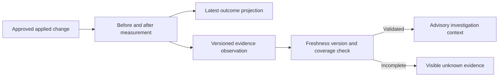

# Advisory production outcome feedback

`amem rsi outcome` still writes the current verdict per change to `rsi_outcomes`.
It now also appends a versioned observation to the existing `rsi_evidence` table.
There is no new table, routine, model call, promotion permission or Undo action.

The observation format is `production-outcome/1`, kind `production-outcome`, system
`supabase`. A unique external reference binds the change, observation time and
canonical payload. Repeating the same observation is idempotent. A later check
keeps an additional observation rather than overwriting the earlier evidence.
The writer uses `INSERT ... ON CONFLICT DO NOTHING`; it never updates historical
observations. The existing evidence table itself remains a general-purpose table,
so this is an application write contract, not a new database immutability trigger.

## Identity and authority

Each observation names its edit/proposal, rule, target, expected before/after file
hashes, artifact hash when available, apply time, input windows, counts, rates,
statistical method and source coverage. Proposal file versions come from its
stored artifact manifest. Edit file versions come from its recorded apply result.
The observation retains the method's actual thresholds. Apply time is explicitly
marked as a promotion timestamp or the older edit-row-created-time proxy.
The consumer compares the expected after hash to freshly measured current bytes.
It does not infer what an older process loaded from today's file.

A skill-score candidate names a skill file, not its section. Its outcome rule is
therefore derived from the actual persisted writer `implementation.section_id`.
The synthetic improve manifest rule ID is not used as if it were a source section.
A skill proposal lacking that exact section stays unmeasured with a reason.

For each side, coverage counts stored production non-eval sessions naming the
instruction source, scanned sessions, exact observed/reconstructed file versions,
and deviations graded against those versions with known authority. Full coverage
requires the same eligible/scanned/version-verified cohort and verified deviation
counts. Composite or unresolved instruction sources remain incomplete. This is
coverage of stored rows; it does not assert that every eligible source transcript
was ingested.

Old deviations with NULL `instruction_authority` stay unverified. Backfilled
session instruction entries do not retroactively prove the version used by an old
grading run. The previous before/after result is preserved for compatibility, but
it cannot become validated feedback merely by resolving its row ID.

## Read and reconsideration contract

`production_feedback.for_candidate(conn, candidate, current_sha256, now=..., limit=6)`
reads a bounded number of exact-rule observations. It returns the reference,
status, reason, metrics and observation/expiry times. It refuses supporting status
for stale observations, expired measurement windows, wrong current bytes,
incomplete coverage, mixed changes or immature results.
Only the latest observation per evidence generation is returned. Repeated checks
of an unchanged cohort remain in history but are not counted as independent
supporting findings.

`rsi_evidence_pack.build_pack(..., current_instruction_sha256=<fresh hash>)` adds
these observations to the existing bounded evidence pack. Without a supplied
current version, generic evidence references and delta records remain unlinked
context. Merely resolving a subject does not prove currency or completeness.
The consumer uses read-only connections and does not refresh observations.

`production_feedback.reconsider(candidate, finding, current_sha256, now=...)`
returns a decision; it does not mutate a candidate. A tested/rejected candidate
can be reconsidered only if all of the following are true:

- The observation is validated, fresh, exact-rule and newer than the candidate's
  last consideration.
- Its negative/no-change observation needs investigation. A positive result is
  context only, never a reason to promote or reopen a failed idea automatically.
- This generation has not already been considered.
- The candidate explicitly records a different last-tested instruction version,
  or at least five newly verified after-sessions have accrued beyond its recorded
  prior feedback cohort. Unknown prior versions/cohorts are not guessed.

The nightly integration must record `production_feedback_generation`,
`production_feedback_sessions_after` and `last_tested_instruction_sha256` when it
actually considers/tests that version. It must preserve old experiment history,
attempt counts and negative verdicts. The helper is deliberately advisory: no
apply, approval, promotion or Undo function is reachable from it.

Generation identity excludes collection time. Rechecking the same cohort, window,
intervention and measurements cannot make an unchanged failed idea new again.
Observations expire after seven days. A repeatedly refreshed observation of an
apply-centered window that ended more than seven days ago is also stale. The
existing fixed-window outcome check is not a rolling long-term regression study.

## Verification and limits

Focused tests use a throwaway local Postgres and SDK tripwires. They cover positive
and negative observations; stale record/window; current-version mismatch; old NULL
authority; incomplete scans; composite/unknown evidence; idempotent history;
latest-projection compatibility; read-only evidence-pack consumption; and bounded,
generation-aware reconsideration without changing candidate history.

There are no causal claims. Before/after changes can reflect task mix, model,
difficulty, scanning or environment differences. These limitations remain explicit
even for an observation with complete version/measurement coverage.

No production backfill or scheduled run was triggered during implementation.
Dry-run outcome checks retain their existing no-write contract and do not append
history. Earlier observations that were never stored cannot be reconstructed by
claiming today's values were observed then.

In one disposable local database sample with 20 fixture sessions, coverage plus
one observation insert took 1.848 ms. Its metrics JSON occupied 1,981 bytes and
the JSONB column occupied 1,532 bytes. Existing relation pages absorbed that sample
without additional allocated pages. This is one local sample, not a production
latency or storage-growth guarantee. No tokens or model calls were used.

The focused outcome/evidence/feedback regression command passed 67 tests. Nightly
shared-file hooks are integrated by the parent after the budget/writer changes;
the final integration gate and naturally scheduled execution remain separate
acceptance evidence.
