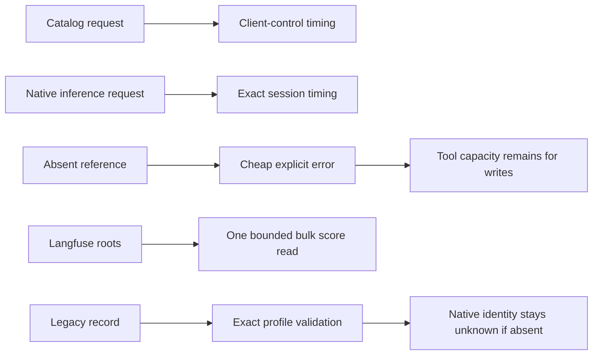

# Scheduled-run follow-up — 2026-10-27

Scope: fix API attribution, Codex output starvation, Langfuse bounded reads, historical replay recovery and missing provider score presentation. No paid experiment/model run, promotion, production backfill, budget increase or isolation relaxation. Publication remains authorized by Vilmer's earlier instruction to push tested changes to main.

## What actually happened

The naturally scheduled 01:30 CET run used night key `2026-10-26`, selected one of ten considered candidates and completed one Meltdown experiment. Five candidates had no applicable test case and four received triage wait. These were not cash skips. The API estimate was USD0.07 (five Jev triage calls and two provider evaluation calls), with USD0.93 remaining and no outstanding reservation. Subscription billing is unknown.

Claude DID run: six agent attempts, all six output checks passed. Codex also ran six attempts; all six output checks failed. Jev DID evaluate both providers: Claude confidence0.25/effect improves, Codex confidence0.71/effect improves. Those are evaluator judgments, not proof of acceptance. The final policy verdict remained INCONCLUSIVE (Claude NO_EFFECT; Codex INCONCLUSIVE). No proposal was staged. The brief incorrectly looked only at empty aggregate judge/Jev fields and hid the populated provider_results; reporting now renders providers separately without merging their evidence or changing verdicts.

Evidence: `~/sandbox/nights/2026-10-26/report.json`, experiment `exp-20261026-63a57bf4`, `~/sandbox/replays/<experiment>/{claude,codex}/runs`, matching artifact `ffeb5296257e532335a49f88acc208fad7bd10116d15ac12e6d0c913b70c7c28`, and `~/.claude/parent/reports/rsi-brief-2026-10-26.md`.

## Root causes and changes

1. **API population and routing.** Native Codex0.163.0 also emits `codex.api_request` for `/models`, without conversation/model fields. A no-generation metadata test (initialize, model/list, shutdown; no thread/start or turn/start) captured that exact shape on an isolated ephemeral loopback receiver. Raw payloads were never saved and no record was posted to production. Known catalog traffic is now classified as client-control time, excluded from task-session eligibility/inference time; unknown old/no-endpoint rows remain unknown. Native HTTP-status and event-timestamp fields are recognized. Health counters distinguish attributed API, unknown API and control observations. Timing semantics version3 and deterministic-analysis version2 preserve the changed population meaning. Anonymous method2 IDs remain stable on exact redelivery, with guarded in-place enrichment and no older-spool downgrade. Dedicated nightly Codex auth homes also lacked the interactive telemetry configuration; fixed local exporter overrides, privacy checks and bounded graceful flush make future session-bearing events observable through the existing collector. Natural inference capture is not proved by the metadata test.
2. **Codex file starvation.** The tool API schema was correct. Each of six attempts read the skill and README, then spent six container calls probing absent skill-reference files. The unchanged eight-container limit was exhausted before output writes. Missing paths are now validated/reported before container execution, a bounded snapshot inventory tells the client what exists, and a separate bounded validation-request limit prevents infinite probing. Fixed error codes survive the RPC response. Local mocked client and networkless Docker fixtures must write real film.json/script.md; no test accepts completion prose alone.
3. **Langfuse reads.** The old dataset-less path queried scores separately per trace. A twelve-trace fixture required fifteen requests, at least29.4s of Cloud rate-limit spacing, outside the existing20s provider budget. Per-request retries could also outlive that budget. Bulk explicit trace-ID filtering removes that fanout. A shared deadline covers health, query steps, throttling, HTTP attempts and pages through both policy wrappers. Retries are disabled only inside bounded reads. Missing/unbound score subjects and incomplete/repeated pagination are explicit errors. No timeout increase or upload behavior change. A review also caught slow streamed bodies outliving socket inactivity timeouts; an optional total HTTP socket deadline now covers response consumption. OS DNS lookup remains non-cancellable, but an expired connection cannot proceed when it returns. The exact HTTP operation causing the saved timeout remains unproven.
4. **Historical identity recovery.** Thirty-six old provider records omitted row.profile while their directory, replay config and exact run ID agree on it. Validation now recovers that explicit profile instead of raising generic ValueError. All42 saved old attempt identities validate; none records a native client ID or start clock. These cannot become fabricated session links. Late weaker repairs preserve stronger native evidence, and reconciliation refuses a session explicitly bound to another attempt. Error details are bounded with complete counts/reason codes.

## Evidence and limits

Focused regressions cover native OTLP shapes/privacy, scoped coverage, collector counters, provider deadline forwarding, exact historical identities/idempotency/conflicts, successful actual file mutation, provider-separated score rendering and fixed exporter settings. The installed standalone Codex0.163.0 also passed a real config/read-only smoke test with an empty dedicated private HOME and no account/read, model/list, thread/start or turn/start. Its effective native isolation and fixed local OTel settings passed the same runtime verifier. A broken unrelated Homebrew npm wrapper was not used as the nightly client. Full clean-commit integration acceptance and publication are recorded in the parent implementation report after completion.

No old database rows or reports were rewritten. No manually forced nightly/daily job ran. Historical native IDs cannot be recovered from missing bytes. New Codex inference events and real output quality require the next natural run. A bounded external Langfuse read can establish present availability, not the past cause of a timeout. Other provider meter counters describe logical calls, not necessarily wire attempts or provider invoices.

Primary protocol evidence: OpenAI Codex source at rust-v0.163.0 (`otel/src/events/shared.rs`, `model-provider/src/models_endpoint.rs`), the installed0.163.0 generated app-server schema, official Codex telemetry docs and Langfuse Scores API v3 documentation. The latter documents comma-separated traceId filters and fields=subject with trace/observation identity. No third-party write endpoint is added.
