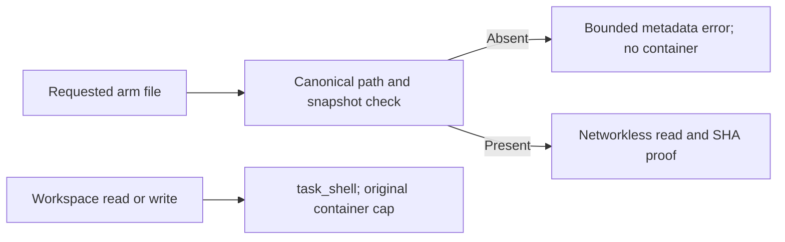

# Missing Codex output files and hidden provider judgments

## Observed night

The 2026-10-26 report's `exp-20261026-63a57bf4` contains six completed Codex attempts with failed file checks,
not six successful task deliveries. Each attempt used exactly eight isolated bridge containers:

1. Read the selected Meltdown SKILL.md successfully.
2. Read README.md through task_shell successfully.
3. Try six absent `reference/` files: reel, lessons, engine, look, plan and review.

The six command hashes match the bridge's generated arm-read commands for those exact missing paths. Each
returned exit 1. No corresponding support file exists in either sanitized arm. All eight container slots were
therefore spent before the required writes. The final client text reports unavailable/failed task tools and
provides intended file contents instead; the workspace diff is empty and the check says film.json missing.

The saved evidence does not retain every unlaunched tool request, so it cannot prove the precise rejected
ninth call. It does prove there was no remaining container capacity for any write. A representative mocked
protocol sequence reproduces this resource starvation and now reaches successful writes with the fix.

## Fix

The client receives a bounded, metadata-only snapshot inventory and an explicit distinction between arm reads
and writable workspace operations. Missing canonical arm files are rejected before Docker execution and do
not consume container capacity. They consume a separate bounded request allowance: at most four times the
configured container limit, capped at 256 requests. The configured eight-container limit is unchanged.

Symlink escapes, parent traversal and outside paths remain refused. No host instruction/support files are
copied into the experiment. Missing metadata failures cannot create verified exposure records. Available
file contents still come from the credential-free networkless worker with the existing hash check.

The protocol handler preserves fixed `arm_file_not_in_snapshot`, `tool_call_limit` and `tool_request_limit`
codes, remaining capacity and a safe explanation instead of hiding everything as `isolated_tool_failed`.
An exhausted request/container cap stops Codex explicitly. Raw exceptions, client stderr, arguments, auth and
private host paths are not returned. The bridge contract/version and effective tool-context SHA are recorded.

The installed `codex-cli 0.163.0` generated its experimental JSON schema offline. Its existing function-tool
definitions (`type=function`, `name`, `description`, `inputSchema`) and responses (`contentItems/inputText`,
`success`) were already correct. No native tool, permission profile, environment or network allowance was
enabled to make writes work. The writing tool remains the existing isolated bridge.

## Provider reporting

The combined experiment deliberately has aggregate `judge=null` and `jev=null`. The separate Claude and
Codex `provider_results` both contain judge and live Jev observations. The brief previously dropped those
nested results and printed that judge/Jev were absent. It now displays each provider's check rates and
judgments separately. Claude's six checks passed; Codex's six did not. Their statistics are never pooled.

Displaying provider evidence does not change a bound evaluation's independence state, the combined verdict,
proposal validity, Apply blockers or the human approval/freeze boundary. Missing judgments are identified
only for the provider actually missing them. Old single-provider reports keep their existing rendering.

## Prospective API timing export

The dedicated Codex client does not inherit the everyday client's OTel configuration. It now receives fixed
CLI-only overrides for JSON logs to `http://127.0.0.1:43927/v1/logs`, the existing local collector. Raw prompt
logging is false; metrics and trace exporters are disabled; no headers or TLS credential configuration is
accepted. Effective config is checked before generation. Nested overrides use valid TOML inline tables.

Closing stdin allows graceful client shutdown and asynchronous export. It waits at most two seconds and
never beyond the existing RPC deadline, then preserves process-group kill cleanup. Successful file work or
valid export configuration does not prove delivery: runtime evidence still says telemetry delivery unverified.
The existing collector owns payload filtering. No new collector, service or global config was installed.

Official interface references: [Codex app-server](https://learn.chatgpt.com/docs/app-server) and
[OTel configuration](https://learn.chatgpt.com/docs/config-file/config-advanced). The actual installed protocol
schema was generated without authentication or inference; no live model/authentication probe was performed.

## Local verification

- Mocked Codex protocol plus actual disposable workspace writes: selected arm read, README read, six missing
  references, film.json/script.md writes and checks. Four container executions remain below eight.
- Real pinned networkless Docker worker: six missing-reference preflights use zero containers; a verified read
  and a shell write create both files in the disposable workspace with the arm unchanged. Two containers used.
- Request-limit refusal, outside/symlink paths, bounded inventory, SHA integrity, native-tool exclusion, strict
  model/effort/config, telemetry endpoint/privacy drift, valid TOML, EOF flush and deadline cleanup are tested.
- Separate-provider report fixture has top-level NULL judgments and real-shaped nested provider results; the
  rendered brief shows both providers and no false absence or pooled statistic.

No paid model calls, production data writes, full nightly run, promotion or push occurred. Natural model
behavior and actual inference-event delivery remain runtime acceptance work. No standalone `bsc` token was
found in the relevant code or saved experiment artifacts; its intended meaning remains unknown.
