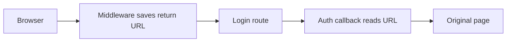

## Result

After login, users now return to the page they came from.

## Important changes

- The middleware saves the original URL before it sends the user to login.
- The auth callback reads that URL and redirects there.
- The login route passes the URL through.

## Diagram

## Verification

The 48 integration tests pass. The page was not opened in a browser, so this is not verified in the app.

## Next action

Open the login page in the browser and check one redirect.

## Skills, Plugins or MCPs used

- Supabase MCP
- systematic-debugging
