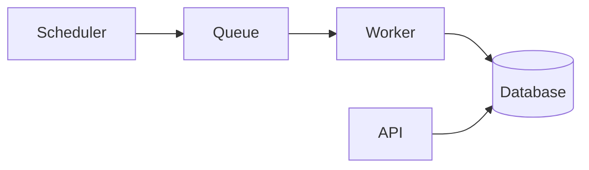

## Result

The nightly import now runs through the job queue instead of cron. Each tenant gets its own job, and failed jobs retry.

## Important changes

- **Scheduler:** enqueues one job per tenant each night.
- **Worker:** consumes the jobs and retries a failed job.
- **API:** shows the status of each job.
- **Database:** a new migration adds the jobs table.

## Diagram

## Verification

- The full test suite passes.
- The smoke run passes.
- Not tested: the migration was not applied to the hosted database.

## Next action

Decide when to apply the migration to the hosted database. The new import cannot run there before that.

## Skills, Plugins or MCPs used

- Vitals MCP
- Railway plugin
